# Guia Completo de Arquitetura, Migração e Extração de Assets: Magic Campus -> Modern Engine

Este documento documenta formalmente a engenharia reversa, decodificação binária, extração de assets e a nova arquitetura do projeto **Magic Campus Modern Engine**, migrando do antigo cliente monolítico Flash (**ActionScript 3 / SWF**) para uma stack moderna, desacoplada e multiplataforma: **Studio Low-Code (Admin) + Servidor Autoritário + Cliente WebGL/HTML5 (Pixi.js) / Android APK (Capacitor para Google Play)**.

---

## 1. Visão de Game Design: Action Auto-Battler em Arena

### 1.1. Separação Estrita de Lógica e Assets
* **Descarte de Fórmulas Originais:** O cliente e servidor originais do Magic Campus utilizavam um sistema de turnos lento e engessado baseado em fórmulas obsoletas de ActionScript 3 e tabelas estáticas.
* **Nova Filosofia:** O projeto utiliza **única e exclusivamente os ativos audiovisuais originais** (spritesheets, direções, ícones, partículas de magia, efeitos sonoros).
* **Novo Combate:** Um sistema dinâmico de **Action Auto-Battler em Arena em Tempo Real**:
  * Ao colidir com um monstro no mapa ou aceitar um desafio, as entidades entram em uma arena de batalha.
  * Jogadores, companheiros (pets) e monstros posicionam-se e combatem automaticamente em tempo real.
  * O combate é regido por barras de energia/mana, tempos de recarga (*cooldowns*), alcances de ataque e conjuração de habilidades especiais e supremas conforme os personagens acumulam energia.
  * Todo o sistema de atributos (HP, MP, Ataque Físico, Poder Mágico, Defesa, Velocidade de Ataque, Esquiva, Crítico) e a árvore de habilidades são desenvolvidos **100% do zero**, pensados para balanceamento competitivo moderno.

---

## 2. Arquitetura em 3 Camadas (Studio, Servidor, Cliente)

```mermaid
flowchart LR
    subgraph Studio["1. Studio / Engine (Admin)"]
        direction TB
        S1["Interface Low-Code"]
        S2["Editor de Mapas & Spawns"]
        S3["Compositor de Classes & Skills"]
        S4["Exportador JSON / Catalogs"]
    end

    subgraph Server["2. Servidor Autoritário"]
        direction TB
        A1["Serviço de Salas / Instâncias"]
        A2["Simulação de Combate Auto-Battler"]
        A3["Validação Física e Anti-Cheat"]
        A4["Persistência de Dados (DB)"]
    end

    subgraph Client["3. Clientes Multiplataforma"]
        direction TB
        C1["Motor Pixi.js (WebGL 2.0)"]
        C2["Atlases WebP Otimizados"]
        C3["Web (HTML5 / Desktop & Mobile)"]
        C4["Android APK (Google Play / Capacitor)"]
    end

    Studio -->|Configs e Balanço| Server
    Server <==>|WebSockets / State Sync| Client
```



### 2.1. Camada 1: Studio Low-Code (Ambiente Administrativo)
* Inspirado no fluxo de criação de engines visuais (como RPG Maker e Godot):
  * Permite carregar os mapas 2.5D, posicionar NPCs, definir zonas seguras e áreas de monstros com interface visual interativa de arrastar e soltar.
  * Catálogo de criação de classes: utiliza o acervo das 46 skins de personagens extraídas para compor novas classes personalizadas, atrelando animações de golpe, magia e supremo.
  * Gerador de habilidades: associa ícones originais, animações de conjuração e efeitos visuais (VFX) com novos scripts de dano e status.
  * Gera manifestos JSON unificados consumidos pelo servidor e pelo cliente.

### 2.2. Camada 2: Servidor Autoritário (Authoritative Server)
* Toda a lógica crítica de jogo reside no servidor:
  * Posições de jogadores no mapa, validação de colisões com a malha binária (`collision.bin`), inventário e trocas.
  * Em combate de arena, o servidor roda a simulação física dos auto-ataques e habilidades com *ticks* fixos (ex: 20 a 60 Hz).
  * O cliente apenas recebe eventos de animação (`PLAY_ATTACK`, `APPLY_DAMAGE`, `CAST_SKILL`), garantindo imunidade total contra manipulação de vida, velocidade ou dano no cliente.

### 2.3. Camada 3: Clientes Multiplataforma (Web & Mobile APK)
* Desenvolvido em **Pixi.js (JavaScript ES6+ / WebGL 2.0)**:
  * Um único código-fonte serve tanto para a versão web rodando em qualquer navegador moderno quanto para empacotamento nativo em **Android APK** utilizando **Capacitor**.
  * Aceleração de hardware com zero dependência de plugins externos.
  * Interface responsiva com Joystick Analógico Virtual, Tap-to-Move e botões ergonômicos para polegares.

---

## 3. Padrão de Assets: Texture Atlas WebP vs. Arquivos Soltos

### 3.1. O Problema Crítico de Arquivos Soltos
O acervo do Magic Campus contém mais de **350 criaturas/pets** e **46 modelos de classes/skins**. Cada criatura possui em média 8 direções e até 8 ações, totalizando cerca de **700 frames por criatura**:
$$\text{Total de frames} \approx 350 \times 700 \approx 245.000 \text{ frames!}$$

Se esses frames fossem extraídos como imagens PNG soltas:
1. **Colapso de Sistema de Arquivos:** Criar 250.000 arquivos PNG em pastas individuais congela o Windows Explorer, inviabiliza commits no Git e causa erros de estouro de descritores de arquivo.
2. **Impacto na Rede e Mobile:** Um navegador ou dispositivo móvel teria que abrir milhares de requisições HTTP, tornando o carregamento inicial proibitivamente lento.
3. **Consumo de Memória de Vídeo (VRAM):** Cada PNG individual vira uma textura avulsa no WebGL, forçando centenas de trocas de textura (*texture binding*) por frame e derrubando o FPS no celular.

### 3.2. A Solução: Spritesheets WebP + JSON Metadata
Todas as animações de cada entidade são compactadas em **Texture Atlases WebP** (`atlas.webp`) acompanhados de seus metadados (`atlas.json` e `visual_meta.json`):
* **Formato WebP de Alta Eficiência:** Oferece compressão com ou sem perdas superior ao PNG, reduzindo o tamanho total do acervo para **menos de 100 MB** (dentro do limite recomendado pela Google Play Store para download imediato).
* **Renderização Otimizada no Pixi.js:** O Pixi.js carrega o atlas diretamente via `PIXI.Assets.load('atlas.json')` como um `PIXI.Spritesheet`. A GPU renderiza todas as animações com **1 único Draw Call**.
* **Total de Arquivos:** Reduzido de 250.000 para ~700 arquivos no total.

---

## 4. Engenharia Reversa do Flash (AS3 / SWF)

### 4.1. Sistema de Nomenclatura e Endereçamento (`UrlUtil`)
No cliente original do Magic Campus, todos os arquivos de recursos dentro da pasta `frontend/s/res/` utilizam **MD5 Hashing** no nome para evitar duplicações e facilitar cache HTTP.

A classe `com.qeedoo.game.utils.UrlUtil` e `GamePredef` geram o caminho canônico do arquivo antes de aplicar o hash MD5:
* **Padrão de URL:** `resource/{pasta}/{PREFIXO}_{ID:06d}.swf` (ou `.jpg`, `.png`)
* **Cálculo do Hash:** `md5("resource/" + caminho_do_recurso)`

#### Exemplos de Mapeamento Resolvido:
* **Mapa 1 (Background):** `resource/scene/SCENE_000001.jpg` -> MD5: `36d51dd37392edf908666bced3544007`
* **Guerreiro Base (Tier 1):** `resource/creature/PC_MALE_000001.swf` -> MD5: `b68e68f7e6ed33ca378b507e60664d2b`
* **Guerreiro Evoluído (Tier 2):** `resource/creature/PC_MALE_000011.swf` -> MD5: `05a8cd74b99040be44e03b52f6ff1adb`
* **Mago Base:** `resource/creature/PC_MALE_000002.swf` -> MD5: `a0008db4b557457d3063cafd295ac9df`
* **Pose de Montaria:** `resource/creature/PC_MALE_100001.swf` -> MD5: `64a4277d38b4c4f762a45dfdec017e38`
* **Máscaras de Sobreposição do Mapa 1:** `resource/scene/SCENE_000001_MASK.swf` -> MD5: `02fa35b54203588f7ee339dfd10cfab5`
* **Cogumelo Selvagem (Criatura 15):** `resource/creature/NPC_CRE_000015.swf` -> MD5: `28af28f7cb24a4660eccf8576a787c5d`

---

## 5. Extração e Decodificação de Elementos do Mundo

### 5.1. Imagem de Fundo (Background)
* Extraída diretamente do hash correspondente a `SCENE_{ID}.jpg` (Mapa 1: `2000 x 1500` pixels).

### 5.2. Máscaras de Primeiro Plano (Foreground Masks / Telhados e Árvores)
* **Arquivo:** `SCENE_{ID}_MASK.swf`.
* Contém tags SWF `DefineBitsJPEG3` (Tag 35), que armazenam uma imagem JPEG comprimida acompanhada de um canal de transparência Alpha comprimido via Zlib.
* Coordenadas convertidas de Twips para Pixels:
  $$\text{pixel} = \frac{\text{twips}}{20}$$
* As coordenadas $(X, Y)$ e dimensões $(W, H)$ de cada máscara são exportadas para `masks.json`.

### 5.3. Malha de Colisão Binária dos 76 Mapas (MAP_HIT_NEW.swf -> collision.bin)
* **Engenharia Reversa de Stride no AVM2:**
  No Flash original (HitTestContainer.as), a colisão de 1-bit é indexada por:
  \\text{idx} = (y \\times \\text{\\_mapWidth}) + x
  \\text{byte\\_idx} = \\text{idx} \\gg 3, \\quad \\text{bit} = (\\text{bytes}[\\text{byte\\_idx}] \\gg (\\text{idx} \\& 7)) \\& 1
  O parâmetro $\\text{\\_mapWidth}$ atua como o **stride exato da matriz de bits**. Uma diferença de apenas 1 pixel no stride causa um cisalhamento diagonal progressivo de $ pixels a cada linha, corrompendo a caminhabilidade do mapa inteiro.
* **Extração Direta do Bytecode ActionScript 3 (Tag 72 DoABC):**
  Em vez de fatorar comprimentos de bits arbitrariamente, o extrator decompila a classe ClassBytes<hash> de cada mapa e localiza as instruções de atribuição de propriedade (setproperty 0x61) para width e height. Os valores são lidos com 100% de precisão de seus opcodes e constant pools:
  * pushdouble (0x2f) -> constante em cpool.doubles (ex: Mapa 1: 2031.45 x 1530.4).
  * pushint (0x2d) -> constante em cpool.ints (ex: Mapa 4: 3076 x 2095, Mapa 67: 5760 x 5056).
  * pushshort (0x25) ou pushbyte (0x24) -> valores imediatos.
* **Calibração Universal dos 76 Mapas:**
  Todos os 76 mapas foram calibrados (	ools/update_all_map_metadata.py), garantindo que col_width e col_height correspondam bit a bit à malha binária original.
* **Sincronização de Texturas Reais:**
  6 mapas que possuíam dimensões de placeholder no SQL original (como Mapa 66 e Mapa 67) tiveram seus metadados de largura e altura sincronizados com as dimensões reais de suas imagens de fundo (g.jpg).
* **Execução em Tempo Real na Web/Mobile ((1)$ sem custo de CPU):**
  `javascript
  function isWalkable(x, y) {
    const ix = Math.floor(x);
    const iy = Math.floor(y);
    if (ix < 0 || ix >= MAP_WIDTH || iy < 0 || iy >= MAP_HEIGHT) return false;
    if (!colBytes || COL_WIDTH <= 0 || COL_HEIGHT <= 0) return true;
    if (ix >= COL_WIDTH || iy >= COL_HEIGHT) return false;
    const idx = iy * COL_WIDTH + ix;
    const byteIdx = idx >> 3;
    if (byteIdx >= colBytes.length) return false;
    return (colBytes[byteIdx] & (1 << (idx & 7))) !== 0;
  }
  `

---

## 6. Sistema de Animação e Ponto de Registro Fixo

### 6.1. Mapeamento das 8 Direções Isométricas (0 a 7)
O Magic Campus utiliza 8 direções numeradas no sentido anti-horário:
* `0`: Sul (Frente / Baixo)
* `1`: Sudeste (Baixo-Direita)
* `2`: Leste (Direita)
* `3`: Nordeste (Cima-Direita)
* `4`: Norte (Costas / Cima)
* `5`: Noroeste (Cima-Esquerda)
* `6`: Oeste (Esquerda)
* `7`: Sudoeste (Baixo-Esquerda)

Conversão angular:
```javascript
function calculateDirection(dx, dy) {
  const angle = Math.atan2(dy, dx) * (180 / Math.PI);
  let sector = Math.round((90 - angle) / 45);
  return ((sector % 8) + 8) % 8;
}
```

### 6.2. Catálogo de Ações de Combate e Movimento
| Ação ID | Constante AS3 Original | Nome / Visual | Qtd. Frames | Comportamento |
| :---: | :--- | :--- | :---: | :--- |
| **0** | `BH_BREATH_SLOW` | Parado / Respirando | 27 frames | Loop contínuo (*Idle*) |
| **1** | `BH_RUN_NORMAL` | Caminhada Lenta | 8 frames | Loop (passo curto) |
| **2** | `BH_RUN_FAST` / `BH_RUSH` | Corrida Rápida | 16 frames | Loop contínuo de movimento |
| **3** | `BH_ATTACK` | Golpe Físico / Estocada | 10 frames | Toca 1 vez e retorna a 0 |
| **4** | `BH_DEAD` | Caído / Derrotado | 1 frame | Trava no chão até levantar |
| **5** | `BH_HURT` | Tomando Dano (Reação) | 7 frames | Flash vermelho e volta a 0 |
| **6** | `BH_DEFENCE` | Postura de Defesa / Guarda | 7 frames | Toca e retorna a 0 |
| **7** | `BH_MAGIC` | Conjuração / Magia | 12 frames | Pose de conjuração e volta a 0 |
| **8** | `BH_PREPARE` | Buff / Postura Tática | 27 frames | Toca e retorna a 0 |
| **9** | `BH_HEAVY_ATTACK` | Golpe Pesado / Corte | 16 frames | Golpe avançado e volta a 0 |
| **10** | `BH_ULTIMATE` | Habilidade Suprema (*Special*) | 32 frames | Sequência suprema completa |

### 6.3. Solução do Bounding Box Unificado & Calibração de Solo (Pés no Chão)
No Flash original, o ponto de registro ficava entre os pés. Ao extrair os bitmaps de múltiplas animações (incluindo golpes descendentes e a animação de derrotado/caído onde o corpo jaz no solo), a caixa delimitadora unificada (*Union Bounding Box*) torna-se significativamente mais alta que a postura de repouso do personagem.

**O Problema do Personagem Flutuante:**
Fixar cegamente o ponto de pivô em `anchor = (0.5, 1.0)` fazia com que personagens de pé ficassem de 15 a 45 pixels acima da sombra/chão, criando a impressão visual de "flutuação".

**A Solução: Calibração Dinâmica de Âncora nos Pés (`tools/calibrate_all_anchors.py`):**
1. O algoritmo analisa todos os frames de postura de pé / repouso (Ação 0: *Idle/Breath* nas 8 direções).
2. Para cada frame, localiza a coordenada máxima não-transparente do solo ($Y_{\text{feet}} = \max(\text{bbox}[3])$).
3. A âncora vertical calibrada é computada proporcionalmente à altura da folha:
   $$\text{anchor}\_y = \frac{\max(Y_{\text{feet}})}{\text{height}}$$
4. Essa âncora calibrada é persistida em `visual_meta.json` e no `catalog.json` de:
   * **46 Classes e Skins de Personagens** (ex: `0.8504` para Guerreiro, alinhando a base dos pés com exatidão matemática a $Y=0$).
   * **20 Montarias Clássicas e Celestiais**.
   * **533 Monstros e Pets**.
5. No cliente Pixi.js, o motor atualiza a âncora dinamicamente de acordo com os metadados do modelo ativo:
   ```javascript
   const anchorY = currentMeta && currentMeta.anchor ? currentMeta.anchor[1] : 0.85;
   charSprite.anchor.set(0.5, anchorY);
   ```
   A sombra é desenhada em `(0, 0)`, cravando as solas dos pés do personagem perfeitamente em cima da sombra no solo.

---

## 7. Ferramentas de Extração & Conversão em Lote

### 7.1. Extrator em Lote com Empacotamento de Atlas (`batch_extract_assets.py`)
Para converter todos os 543 monstros e 46 classes para Texture Atlases WebP:
```bash
python tools/batch_extract_assets.py --mode all
```
* **O que o script faz:**
  1. Varre `mcgame/frontend/s/res` mapeando os hashes MD5 de todos os SWFs de monstros (`NPC_CRE_*.swf`) e classes (`PC_MALE_*.swf`, `PC_FEMALE_*.swf`).
  2. Descompacta o cabeçalho Zlib (`CWS` -> `FWS`).
  3. Decodifica tags `DefineBitsLossless2` e `DefineBitsJPEG3` com canal alfa.
  4. Agrupa os frames por direção e ação (`0-0` até `7-10`).
  5. Empacota todas as imagens em uma folha de textura WebP (`atlas.webp`) com algoritmo de empacotamento em grade otimizada.
  6. Gera o manifesto padrão TexturePacker/Pixi.js (`atlas.json`) e o sumário visual (`visual_meta.json`).
  7. Cria os catálogos mestres:
     * `web/assets/monsters/catalog.json`
     * `web/assets/characters/catalog.json`

### 7.2. Extração de NPCs, Montarias e Identificação de Pets
* **NPCs do Mundo Original (`tools/batch_extract_npcs.py`):**
  * Extrai 365 modelos funcionais de NPCs (`NPC_FUNC_*.swf`) para `web/assets/npcs/{id}/`.
  * Cruza com `data_tbl_npc.sql` para extrair nomes autênticos, locais de mapa e gerar `web/assets/npcs/catalog.json`.
* **Estábulo de Montarias (`tools/extract_mounts.py`):**
  * Extrai as 20 montarias clássicas e divinas (Graus 1 a 10) de `data_tbl_mount_dress.sql` e as skins de cavalgar (`PC_MALE_100000..100006`, `PC_FEMALE_100001..100006`, `PC_FEMALE_010005..010020`) para `web/assets/mounts/{id}/` e gera `web/assets/mounts/catalog.json`.
* **Identificação de Pets (`tools/tag_pets_in_catalog.py`):**
  * Cruza o catálogo de monstros com `data_tbl_creature.sql` (`catchable = 1`) e `data_tbl_creature_handbook.sql` (`relate_id`), marcando com exatidão todos os 106 pets e companheiros com insígnias e textos de lore.

---

## 8. Como Executar e Testar

### 8.1. Servidor de Desenvolvimento Local
```bash
python -m http.server 8080 --directory web
```
Acesse no navegador: `http://localhost:8080/`.

### 8.2. Validação no Sandbox de Combate
* Aproxime o personagem do Cogumelo Selvagem ou clique no botão do menu lateral.
* No painel de teste, dispare as animações individuais (Golpe, Magia, Suprema, Defesa, Dano, Caído) para inspecionar os efeitos visuais e o alinhamento corporal.
* Ative o **🔄 Sparring Contínuo** para validar a execução contínua de loops de batalha.
