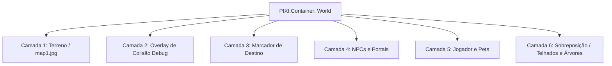

# Guia Completo de Extração e Modernização: Magic Campus -> Pixi.js (Stack Moderna)

Este documento descreve detalhadamente o processo de engenharia reversa, decodificação, extração e migração de assets do cliente original Flash (**ActionScript 3 / SWF**) do jogo **Magic Campus** para uma stack moderna baseada em **Web (HTML5, Pixi.js, Canvas 2D/WebGL e JavaScript ES6+)** com suporte a dispositivos móveis.

---

## 1. Arquitetura Original do Flash vs. Stack Moderna

| Aspecto | Cliente Original (Flash / AS3) | Stack Moderna (Pixi.js / HTML5) |
| :--- | :--- | :--- |
| **Execução** | Flash Player / Adobe AIR plugin | Navegador Web nativo (WebGL / WebGPU / Canvas) |
| **Formato de Assets** | Arquivos SWF compactados com Zlib (CWS) | PNGs transparentes, JPGs e Manifestos JSON |
| **Malha de Colisão** | Bytecode ABC + Bitmask RLE em `Hit.swf` | Binário bruto 1-bit (`collision.bin`) em `Uint8Array` |
| **Camadas (Layers)** | DisplayList hierárquica do Flash | Containers de Camadas ordenadas no PixiJS (`PIXI.Container`) |
| **Sobreposição / Oclusão** | `hitTestObject` e troca de `alpha` | Caixas Delimitadoras AABB 2.5D com interpolação suave |
| **Controles** | Teclado e Mouse para Desktop | Joystick Analógico Virtual Mobile + Tap-to-move |

---

## 2. Sistema de Nomenclatura e Endereçamento de Arquivos (`UrlUtil`)

No cliente original do Magic Campus, todos os arquivos de recursos dentro da pasta `frontend/s/res/` utilizam **MD5 Hashing** no nome para evitar duplicações e facilitar cache HTTP.

A classe `com.qeedoo.game.utils.UrlUtil` e `GamePredef` geram o caminho canônico do arquivo antes de aplicar o hash MD5:

* **Padrão de URL:** `resource/{pasta}/{PREFIXO}_{ID:06d}.swf` (ou `.jpg`, `.png`)
* **Cálculo do Hash:** `md5("resource/" + caminho_do_recurso)`

### Exemplos de Mapeamento Resolvido:
* **Mapa 1 (Background):**  
  `resource/scene/SCENE_000001.jpg`  
  -> MD5: `36d51dd37392edf908666bced3544007`
* **Guerreiro Base (Tier 1):**  
  `resource/creature/PC_MALE_000001.swf`  
  -> MD5: `b68e68f7e6ed33ca378b507e60664d2b`
* **Guerreiro Avançado (Tier 2 / Evoluído):**  
  `resource/creature/PC_MALE_000011.swf`  
  -> MD5: `05a8cd74b99040be44e03b52f6ff1adb`
* **Mago Base:**  
  `resource/creature/PC_MALE_000002.swf`  
  -> MD5: `a0008db4b557457d3063cafd295ac9df`
* **Pose de Montaria:**  
  `resource/creature/PC_MALE_100001.swf`  
  -> MD5: `64a4277d38b4c4f762a45dfdec017e38`
* **Máscaras de Sobreposição do Mapa 1:**  
  `resource/scene/SCENE_000001_MASK.swf`  
  -> MD5: `02fa35b54203588f7ee339dfd10cfab5`

---

## 3. Extração e Reconstrução de Mapas

Um mapa no Magic Campus é composto por 4 elementos fundamentais que precisam ser extraídos e alinhados:

### 3.1. Imagem de Fundo (Background)
* **Origem:** Extraída diretamente do hash correspondente a `SCENE_{ID}.jpg` (ex: Mapa 1 tem dimensões de `2000 x 1500` pixels).

### 3.2. Máscaras de Primeiro Plano (Foreground Masks / Telhados e Árvores)
* **Arquivo:** `SCENE_{ID}_MASK.swf`.
* **Estrutura Interna:** Contém tags SWF `DefineBitsJPEG3` (Tag 35), que armazenam uma imagem JPEG comprimida acompanhada de um canal de transparência Alpha comprimido via Zlib.
* **Coordenadas de Posicionamento:**
  * O Flash armazena o posicionamento no palco na tag `PlaceObject2` (Tag 26) ou nos limites da forma `DefineShape` (Tag 2).
  * As unidades do Flash utilizam **Twips** (`1 pixel = 20 twips`). Para converter para pixels na web:
    $$\text{pixel} = \frac{\text{twips}}{20}$$
  * A coordenada superior esquerda $(X, Y)$ e largura/altura $(W, H)$ de cada máscara são exportadas para um arquivo `masks.json`.

### 3.3. Malha de Colisão Binária (`Hit.swf` -> `collision.bin`)
* **Problema no Flash:** A colisão original ficava em `Hit.swf` em forma de bytecode ActionScript compactado (RLE - Run-Length Encoding).
* **Decodificação:**
  * Descompactamos o array de bytes contido na classe de colisão do mapa.
  * O algoritmo de descompressão RLE gera uma matriz de bits $(W \times H)$, onde:
    * `1` = Chão livre para caminhar (*Walkable*).
    * `0` = Parede, água, montanha ou obstáculo intransponível (*Blocked*).
  * Para o Mapa 1, a malha tem dimensão de `2031 x 1531` bits = **388.683 bytes**.
* **Modernização para Web:**
  * Exportamos esse binário puro descompactado como `collision.bin`.
  * No cliente web (PixiJS), carregamos via `fetch().arrayBuffer()` diretamente para um `Uint8Array`.
  * A checagem de colisão em tempo real é feita por operações bitwise ultrarrápidas ($O(1)$ sem custo de CPU):
    ```javascript
    function isWalkable(x, y) {
      const ix = Math.floor(x);
      const iy = Math.floor(y);
      if (ix < 0 || ix >= COL_WIDTH || iy < 0 || iy >= COL_HEIGHT) return false;
      const idx = iy * COL_WIDTH + ix;
      return (colBytes[idx >> 3] & (1 << (idx & 7))) !== 0;
    }
    ```

### 3.4. NPCs e Portais
* As posições e nomes dos NPCs são extraídos da tabela `data_tbl_npc` (disponível no banco de dados e seeds SQL):
  * Exemplo: `map_id = 1`:
    * NPC Chefe da Guarda: `(1050, 980)`
    * NPC Mestre de Habilidades: `(920, 1150)`
    * NPC Guia da Vila: `(1120, 1020)`
* São exportados para `npcs.json` e renderizados como marcadores interativos no mundo.

---

## 4. Extração do Sistema de Personagens e Animações

### 4.1. Estrutura do SWF de Personagens
Cada personagem é um arquivo SWF autocontido contendo todas as suas direções e ações organizadas por **FrameLabels** (Tag 43):
* O formato dos rótulos é `{direção}-{ação}`:
  * Exemplo: `0-0` = Direção 0 (Sul), Ação 0 (Parado).
  * Exemplo: `2-2` = Direção 2 (Leste), Ação 2 (Correndo).
  * Exemplo: `6-10` = Direção 6 (Oeste), Ação 10 (Habilidade Suprema).

### 4.2. Mapeamento das 8 Direções Isométricas (2.5D)
O Magic Campus utiliza 8 direções numeradas de 0 a 7 no sentido anti-horário:
* `0`: Sul (Frente / Olhando para baixo)
* `1`: Sudeste (Baixo-Direita)
* `2`: Leste (Direita)
* `3`: Nordeste (Cima-Direita)
* `4`: Norte (Costas / Olhando para cima)
* `5`: Noroeste (Cima-Esquerda)
* `6`: Oeste (Esquerda)
* `7`: Sudoeste (Baixo-Esquerda)

A fórmula de conversão matemática angular do analógico para o setor correto é:
```javascript
function calculateDirection(dx, dy) {
  const angle = Math.atan2(dy, dx) * (180 / Math.PI);
  let sector = Math.round((90 - angle) / 45);
  return ((sector % 8) + 8) % 8;
}
```

### 4.3. Catálogo das 11 Ações de Combate e Movimento
| Ação ID | Constante AS3 Original | Nome / Visual | Qtd. Frames | Comportamento |
| :---: | :--- | :--- | :---: | :--- |
| **0** | `BH_BREATH_SLOW` | Parado / Respirando | 27 frames | Loop contínuo (*Idle*) |
| **1** | `BH_RUN_NORMAL` | Caminhada Lenta | 8 frames | Loop (passo curto) |
| **2** | `BH_RUN_FAST` / `BH_RUSH` | Corrida Rápida | 16 frames | Loop contínuo de movimento |
| **3** | `BH_ATTACK` | Golpe Físico / Estocada | 10 frames | Toca 1 vez e retorna a 0 |
| **4** | `BH_DEAD` | Caído / Derrotado | 1 frame | Trava no chão até levantar |
| **5** | `BH_HURT` | Tomando Dano (Reação) | 7 frames | Toca com flash vermelho e volta a 0 |
| **6** | `BH_DEFENCE` | Postura de Defesa / Bloqueio | 7 frames | Toca e retorna a 0 |
| **7** | `BH_MAGIC` | Conjuração / Magia | 12 frames | Toca com pose mágica e volta a 0 |
| **8** | `BH_PREPARE` | Buff / Postura de Combate | 27 frames | Toca animação tática e volta a 0 |
| **9** | `BH_HEAVY_ATTACK` | Golpe Pesado / Corte | 16 frames | Golpe avançado e volta a 0 |
| **10** | `BH_ULTIMATE` | Habilidade Suprema (*Special*) | 32 frames | Efeito supremo completo e volta a 0 |

> **Nota sobre Classes:**  
> Personagens Tier 1 (Base, ex: `PC_MALE_000001`) possuem as ações 0 a 7 (64 animações).  
> Personagens Tier 2 (Evoluídos, ex: `PC_MALE_000011`) possuem as ações 0 a 10 (88 animações).

---

## 5. Alinhamento de Ponto de Registro e Âncora (Pivot Point)

O maior desafio ao extrair animações de Flash para Canvas/PixiJS é que no Flash o ponto de registro $(0, 0)$ fica exatamente **entre os pés do personagem**, enquanto que imagens PNG são ancoradas pelo canto superior esquerdo $(0, 0)$.

Se ancorar incorretamente, o personagem trepida, o nome fica flutuando longe da cabeça e a sombra se desalinha do corpo ao trocar de direção.

### A Solução Matemática de Âncora Fixa:
1. Padronizamos a tela de extração em **200 de largura por 150 de altura**.
2. Nessa resolução:
   * O centro horizontal fica exatamente em $X = 100$ pixels ($100 / 200 = 0.5$).
   * O calcanhar/chão fica exatamente em $Y = 110$ pixels ($110 / 150 = 0.733333$).
3. No Pixi.js, configuramos o sprite:
   ```javascript
   charSprite.anchor.set(0.5, 110 / 150);
   charSprite.position.set(0, 0);
   ```
4. A sombra do chão fica na posição `(0, 0)` do container:
   ```javascript
   shadow.drawEllipse(0, 0, 16, 7);
   ```
5. A etiqueta com o nome do jogador fica centralizada acima da cabeça:
   ```javascript
   playerName.anchor.set(0.5, 1);
   playerName.y = -70; // (ajustado para escala 0.70)
   ```
Dessa forma, independentemente da rotação, escala ou animação ativa, os pés, a sombra e o nome permanecem **100% perfeitamente alinhados**.

---

## 6. Sistema de Renderização em Camadas (Layering)

No Pixi.js, o mundo 2.5D é montado adicionando containers em ordem estrita de profundidade:



### Transparência Suave em Primeiro Plano (Occlusion Fading)
Quando o jogador passa por trás de um telhado ou sob a copa de uma árvore, a camada correspondente tem sua opacidade reduzida suavemente para $35\%$ (`alpha = 0.35`), revelando o personagem:
```javascript
const pBox = { left: player.x - 15, right: player.x + 15, top: player.y - 70, bottom: player.y };
const overlaps = (pBox.right >= mLeft && pBox.left <= mRight && pBox.bottom >= mTop && pBox.top <= mBottom);
mSprite.alpha = overlaps ? 0.35 : 1.0;
```

---

## 7. Como Executar o Projeto Localmente

1. **Pré-requisitos:** Python 3.8+ instalado.
2. **Iniciar o Servidor Web:**
   ```bash
   python -m http.server 8080 --directory web
   ```
3. **Acessar:**
   * No Computador: `http://localhost:8080/`
   * No Celular (mesmo Wi-Fi): `http://{IP_DO_PC}:8080/`

---

## 8. Como Extrair Novos Mapas ou Personagens

Para converter qualquer outro mapa ou personagem do jogo, utilize os scripts inclusos na pasta `tools/`:

### Extrair um novo Personagem:
```bash
python tools/extract_character.py --swf "caminho/para/PC_MALE_000003.swf" --out "web/assets/char3"
```

### Extrair um novo Mapa:
```bash
python tools/extract_map.py --map-id 2 --res-dir "caminho/para/frontend/s/res" --out "web/assets/map2"
```

### Extrair NPCs de um Mapa:
```bash
python tools/extract_npcs.py
```
O script lê as coordenadas, nomes e `res_code` de cada NPC em `data_tbl_npc.sql`, decodifica o hash MD5 da URL original no Flash (`UrlUtil.getUrl()`), extrai os bitmaps de respiração (Lossless2 / JPEG3), calcula o bounding box unificado para travar os pés na base `(0.5, 1.0)`, e gera `web/assets/map1/npcs.json` e todos os frames PNG prontos para o Pixi.js.

O script cuidará automaticamente da descompressão Zlib, extração de bitmaps, leitura de rótulos de timeline, cálculo do pivô e geração do `char_manifest.json` ou `npcs.json`.
