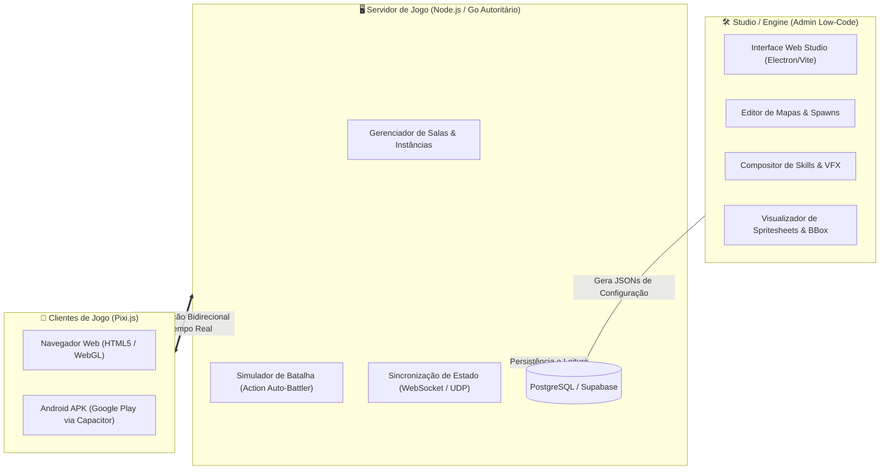

# Magic Campus Rework & Modern Engine (Pixi.js / WebGL / Mobile APK) 🧙‍♂️✨

Um projeto moderno de recriação de engine e modernização do clássico MMORPG **Magic Campus (魔力学堂)**. O projeto migra o acervo original em Flash (**ActionScript 3 / SWF**) para uma arquitetura modular de alta performance baseada em **Web (HTML5, WebGL 2.0, Pixi.js)** e empacotamento mobile nativo para **Android (APK na Google Play via Capacitor)**, acompanhada de um **Studio Low-Code (estilo RPG Maker)** e um **Servidor Autoritário**.

---

## 🎯 Visão do Projeto & Novo Game Design

### 1. Studio Low-Code (Engine Visual estilo RPG Maker)
* **Objetivo:** Uma suíte de ferramentas administrativas e de criação de conteúdo para desenvolvedores e mestres de jogo.
* **Recursos do Studio:**
  * Editor visual de mapas 2.5D com importação de camadas, posicionamento de NPCs e geração de malhas de colisão.
  * Catálogo visual completo de todos os **351 monstros/pets** e todas as **46 skins/classes**.
  * Compositor de habilidades: vinculação visual entre ícones originais, animações de conjuração dos personagens e efeitos de impacto (VFX/SFX).
  * Gerador de tabelas de monstros, grupos de spawn e regras de encontro em arenas.

### 2. Combate: Action Auto-Battler em Arena (Novo Design do Zero)
* **Afastamento do Flash Original:** O jogo original utilizava um sistema de turnos estático, fórmulas antigas e tabelas rígidas. **Nenhuma fórmula, cálculo de dano ou atributo do jogo original é reaproveitado**.
* **Novo Combate:** Inspirado em clássicos modernos como *Teamfight Tactics*, *Auto Chess* e *AFK Arena*:
  * Ao colidir com um monstro ou iniciar um duelo, a batalha ocorre em uma **Arena de Combate Dinâmica**.
  * Personagens, pets e monstros batalham de forma **automática em tempo real**.
  * Cada entidade possui barra de energia, intervalos de ataque dinâmicos, tempo de conjuração, alcances táticos e habilidades que disparam automaticamente conforme o fluxo da batalha.
  * Todas as fórmulas de dano, status, balanceamento, sinergias de classe e inteligência artificial são construídas **100% do zero**.

### 3. Aproveitamento Inteligente de Assets Originais
* O acervo de dados do jogo original é utilizado **exclusivamente para a extração do patrimônio visual e sonoro**:
  * 👾 **Monstros e Pets:** Todos os modelos 2.5D com suas animações completas (8 direções × até 8 ações).
  * 🧙 **Classes e Skins de Personagens:** Todos os modelos masculinos e femininos em alta fidelidade com até 11 ações (incluindo Supremos de 32 frames e montarias).
  * ✨ **Efeitos Visuais (VFX / Skills):** Explosões mágicas, projéteis arcanos e auras.
  * 🎨 **Ícones & Interface:** Ícones de habilidades, armaduras, armas e consumíveis.


### 5. Acervo de Habilidades & Efeitos Especiais (VFX / SFX) 🔮✨
* **Extração Visual Exclusiva:** Conforme a filosofia do projeto, nenhuma fórmula ou cálculo antigo foi importado. Todo o foco foi direcionado para a recuperação integral do patrimônio audiovisual de magias e efeitos:
  * 🔮 **1.923 Habilidades Catalogadas:** Mapeadas com nomes, categorias (Classes, Pets, Despertar, Suporte), tipos de alvo e padrões de área.
  * 🎨 **411 Ícones Oficiais (32×32 PNG):** Extraídos e organizados em `web/assets/skills/icons/`.
  * ⚡ **128 Efeitos Especiais Animados (VFX):** Decompilados a partir dos arquivos SWF originais (`DefineSprite` e vetores Flash) e convertidos em spritesheets WebP compactos com transparência alfa e metadados de duração em `web/assets/effects/`.
  * 📱 **Grimório Interativo no Cliente:** Provador de habilidades no topo do HUD mobile com busca em tempo real, filtros por classe/pet e botão de disparo imediato do efeito visual no jogo.

### 4. Separação Arquitetural em 3 Camadas


1. **Studio / Engine (Admin):** Ambiente administrativo para configurar mapas, monstros, habilidades e balanceamento visualmente sem mexer no código core.
2. **Servidor Autoritário:** Executa as simulações físicas e cálculos de combate no backend para prevenir trapaças (anti-cheat), gerencia salas de arena e sincroniza posições via WebSockets.
3. **Cliente Leve e Portável:** Motor gráfico ultra-rápido em Pixi.js, consumindo Spritesheets WebP otimizados. O mesmo código-fonte é executado na Web e compilado para Android APK na Google Play via Capacitor.

---

## 🌟 Funcionalidades Implementadas

### 🗺️ Sistema de Mapas 2.5D & NPCs Autênticos
* **Renderização em Camadas:** Terreno base (`2000x1500`), entidades dinâmicas com Z-Ordering 2.5D e sobreposições de primeiro plano.
* **NPCs Originais Animados:** Todos os 14 NPCs do Mapa 1 extraídos dos arquivos SWF originais (`creature/NPC_FUNC_*.swf`), com animações completas de respiração em 4 frames em loop, proporção calibrada (`scale = 0.70`), sombras suaves no chão e nomes dourados autênticos.
* **Interatividade com NPCs:** Toque em qualquer NPC para o personagem correr até ele e abrir o diálogo mobile com as falas e saudações dos personagens.
* **Ordenação de Profundidade (Z-Ordering 2.5D):** O jogador passa na frente ou atrás dos NPCs e árvores de forma natural e realista com base na coordenada Y dos pés.
* **Malha de Colisão Binária (1-Bit Binary Mesh):** Extraída diretamente de `Hit.swf` para um arquivo bruto `collision.bin` (`2031x1531`). Checagem de colisão bitwise ultra-eficiente $O(1)$ sem impacto de CPU.
* **Deslize em Paredes (*Wall Sliding*):** O personagem contorna cantos e desliza pelas quinas suavemente sem travar.
* **Transparência de Oclusão (*Foreground Occlusion Fading*):** Telhados de casas e copas de árvores ficam transparentes suavemente (`alpha = 0.35`) quando o jogador passa por trás deles.

### ⚔️ Sistema de Animações e Personagens
* **Alinhamento e Pivô Matemático Exato:** Ponto de registro cravado nos pés `(0.5, 1.0)` através de bounding box unificado, garantindo alinhamento perfeito de sombra, modelo e etiqueta de nome em todas as direções e ações.
* **8 Direções Isométricas (0 a 7):** Sul, Sudeste, Leste, Nordeste, Norte, Noroeste, Oeste e Sudoeste calculadas via trigonometria angular contínua.
* **11 Ações de Combate e Movimento:**
  * `0`: Parado / Respirando (*Idle* - 27f)
  * `1`: Andar lento (*Walk* - 8f)
  * `2`: Corrida rápida (*Run / Rush* - 16f) — **movimentação padrão**
  * `3`: Golpe físico / Ataque (*Attack* - 10f)
  * `4`: Derrotado / Caído no chão (*Dead* - 1f)
  * `5`: Tomando dano com flash de impacto (*Hurt* - 7f)
  * `6`: Defesa / Guarda (*Block* - 7f)
  * `7`: Conjuração / Magia (*Cast* - 12f)
  * `8`: Buff / Postura tática (*Prepare* - 27f)
  * `9`: Golpe pesado (*Heavy Attack* - 16f)
  * `10`: Habilidade Suprema (*Ultimate* - 32 frames completos!)
* **Acervo Completo de Classes & Skins:** 46 modelos originais decodificados (19 masculinos e 27 femininos), permitindo criar livremente dezenas de novas classes no Studio.

### 👾 Monstros, Pets & Sandbox de Teste de Animações
* **Preservação de Todas as Criaturas:** Extração de todos os 543 monstros e pets para o formato de Spritesheet WebP de alta compressão.
* **🐾 106 Pets Identificados & Catalogados:** Cruzamento com as tabelas de contratos e handbook do jogo original (`data_tbl_creature.sql` e `data_tbl_creature_handbook.sql`), permitindo filtrar diretamente todos os companheiros capturáveis (ex: *Gấu Trúc Kungfu*, *Rùa Nika*, *Nấm Đông Cô*, *Cát Hải Tinh*, *Linh Long*, *Ác Long*, *Cô Gái Si Tình*, etc.) com lore e insígnias dedicadas.
* **🐎 20 Montarias Clássicas e Celestiais:** Estábulo dedicado com montarias terrestres e aladas (Graus 1 a 10: *Bạch Mã*, *Hắc Báo*, *Huyết Dực Điểu*, *Bôn Lôi Thú*, *Thanh Long Sư*, *Cửu Vĩ Linh Hồ*, *Hồng Liên Bôn Lôi*, *Hàn Sương Thiểm Điện*, *Viễn Cổ Chiến Hùng*, etc.), equipáveis com animações completas de galope e postura montada!
* **👥 365 NPCs Funcionais com Spawner no Mapa:** Enciclopédia de todos os NPCs originais (mercadores, ferreiros, mestres de guilda, guardas e emissários) com botão para spawnar instantaneamente qualquer NPC no mundo aberto para teste de diálogos.
* **🖼️ Miniaturas em Todos os Catálogos:** Todas as 46 classes, 543 monstros/pets, 20 montarias e 365 NPCs possuem thumbnails WebP otimizadas para navegação visual ágil.
* **Monstro Interativo no Mapa 1:** `Cogumelo Selvagem [Nv. 5]` (*Nấm Đồng Cỏ* / `NPC_CRE_000015.swf`), renderizado no mapa com sombra suave e animação de respiração contínua em escala proporcional (`scale = 0.70`).
* **Sandbox de Animações de Combate (In-Map):**
  * Permite testar golpes físicos, magias arcanas, defesas, reações de impacto e animações de queda tanto do jogador quanto do monstro.
  * Modo **🔄 Sparring Contínuo** em loop infinito para inspecionar a fluidez das trocas de golpes sem interrupções.
  * Textos flutuantes de combate estilizados (`💥 GOLPE!`, `🔮 MAGIA!`, `⚡ COMBO!`, `☠️ ESPOROS!`, `🛡️ DEFESA!`).

### 📱 Interface Mobile-First & Portabilidade APK
* **Joystick Analógico Virtual:** Toque dinâmico e resposta vetorial precisa.
* **Tap-to-Move:** Toque em qualquer ponto livre do mapa para o personagem correr até o local.
* **Grade de Ações Compacta:** Ataque, Magia, Suprema, Defesa, Dano, Caído, Correr e Parar no alcance do polegar.
* **Pronto para Google Play (Capacitor):**
  * Assets compactados em WebP reduzem o instalador APK para menos de 100 MB.
  * Renderização WebGL acelerada por hardware compatível com Android 8.0+.

---

## 📦 Pipeline de Spritesheets WebP (Adequado para Web e Mobile)

Para suportar 351 monstros e 46 classes sem sobrecarregar o sistema com 250.000 arquivos PNG soltos:
* Todas as animações são agrupadas em **Texturas Atlas WebP** (`atlas.webp`) acompanhadas de manifesto estruturado (`atlas.json` e `visual_meta.json`).
* **Vantagens Críticas:**
  * Redução de mais de **99% no número de arquivos** no repositório e no APK.
  * Redução do tamanho total de ~2.5 GB (PNGs soltos) para **~60-80 MB** (WebP de alta qualidade).
  * Carregamento em **1 única requisição HTTP / 1 único upload para GPU**, eliminando gargalos de CPU e quedas de FPS no celular.

---

## 🌐 Jogar Online (GitHub Pages)

A aplicação está configurada para deploy contínuo no GitHub Pages:
👉 **[https://seytanir.github.io/mcrework/](https://seytanir.github.io/mcrework/)**

---

## 🚀 Como Executar Localmente

### 1. Iniciar o Servidor
Com Python instalado, execute na raiz do projeto:
```bash
python -m http.server 8080 --directory web
```

### 2. Acessar
* **No Computador:** [http://localhost:8080/](http://localhost:8080/)
* **No Celular (mesmo Wi-Fi):** `http://{IP_DO_SEU_PC}:8080/`

---

## 📖 Documentação Técnica de Migração

Para entender o processo de engenharia reversa dos arquivos SWF, descompressão Zlib, decodificação da malha de colisão e empacotamento de atlas, consulte o guia completo:

👉 **[GUIA_MIGRACAO.md](GUIA_MIGRACAO.md)**

---

## 📁 Estrutura do Repositório

```text
├── web/                           # Aplicação Web Pixi.js (Pronta para rodar e empacotar em APK)
│   ├── index.html                 # Interface responsiva mobile
│   ├── style.css                  # Estilização moderna e layout de botões
│   ├── main.js                    # Motor Pixi.js, física, colisão e animações
│   └── assets/                    # Assets convertidos e otimizados
│       ├── map1/                  # Background, máscaras, NPCs e collision.bin
│       ├── char1/                 # Guerreiro Base (Tier 1)
│       ├── char11/                # Guerreiro Evoluído (Tier 2 - Ações 0 a 10)
│       ├── char2/                 # Mago Base
│       ├── char_mount/            # Poses de Montaria
│       ├── monsters/              # Atlases WebP de todos os 351 monstros e pets + catalog.json
│       └── characters/            # Atlases WebP de todas as 46 skins de classes + catalog.json
├── tools/                         # Ferramentas Python de extração e conversão
│   ├── batch_extract_assets.py    # Extrator mestre e gerador de Spritesheet Atlases WebP
│   ├── extract_character.py       # Extrator individual de SWF de personagem
│   ├── extract_monster.py         # Extrator individual de monstro
│   ├── extract_npcs.py            # Extrator de NPCs por mapa
│   ├── extract_map.py             # Extrai mapas, máscaras e posicionamentos
│   └── extract_collision.py       # Decodifica malhas de colisão RLE de Hit.swf
├── GUIA_MIGRACAO.md               # Documentação técnica aprofundada da migração e arquitetura
└── README.md                      # Apresentação do projeto e visão de engenharia
```
