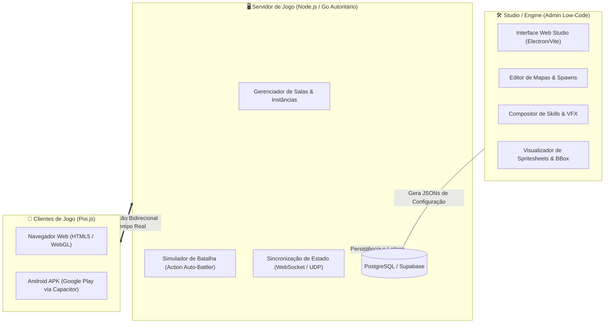

# Magic Campus Rework & Modern Engine (Pixi.js / WebGL / Mobile APK) 🧙‍♂️✨

Um projeto moderno de recriação de engine e modernização do clássico MMORPG **Magic Campus (魔力学堂)**. O projeto migra o acervo original em Flash (**ActionScript 3 / SWF**) para uma arquitetura modular de alta performance baseada em **Web (HTML5, WebGL 2.0, Pixi.js)** e empacotamento mobile nativo para **Android (APK na Google Play via Capacitor)**, acompanhada de um **Studio Low-Code (estilo RPG Maker)** e um **Servidor Autoritário**.

---

## 🎯 Visão do Projeto & Novo Game Design

### 1. Studio Low-Code (Engine Visual estilo RPG Maker)
* **Objetivo:** Uma suíte de ferramentas administrativas e de criação de conteúdo para desenvolvedores e mestres de jogo.
* **Recursos do Studio:**
  * Editor visual de mapas 2.5D com importação de camadas, posicionamento de NPCs e geração de malhas de colisão.
  * Catálogo visual completo de todos os **351 monstros/pets** e todas as **46 skins/classes**.
  * Compositor de habilidades: vinculação visual entre ícones originais, animações de conjuração dos personagens e efeitos de impacto (VFX/SFX).
  * Gerador de tabelas de monstros, grupos de spawn e regras de encontro em arenas.

### 2. Combate: Action Auto-Battler em Arena (Novo Design do Zero)
* **Afastamento do Flash Original:** O jogo original utilizava um sistema de turnos estático, fórmulas antigas e tabelas rígidas. **Nenhuma fórmula, cálculo de dano ou atributo do jogo original é reaproveitado**.
* **Novo Combate:** Inspirado em clássicos modernos como *Teamfight Tactics*, *Auto Chess* e *AFK Arena*:
  * Ao colidir com um monstro ou iniciar um duelo, a batalha ocorre em uma **Arena de Combate Dinâmica**.
  * Personagens, pets e monstros batalham de forma **automática em tempo real**.
  * Cada entidade possui barra de energia, intervalos de ataque dinâmicos, tempo de conjuração, alcances táticos e habilidades que disparam automaticamente conforme o fluxo da batalha.
  * Todas as fórmulas de dano, status, balanceamento, sinergias de classe e inteligência artificial são construídas **100% do zero**.

### 3. Aproveitamento Inteligente de Assets Originais
* O acervo de dados do jogo original é utilizado **exclusivamente para a extração do patrimônio visual e sonoro**:
  * 👾 **Monstros e Pets:** Todos os modelos 2.5D com suas animações completas (8 direções × até 8 ações).
  * 🧙 **Classes e Skins de Personagens:** Todos os modelos masculinos e femininos em alta fidelidade com até 11 ações (incluindo Supremos de 32 frames e montarias).
  * ✨ **Efeitos Visuais (VFX / Skills):** Explosões mágicas, projéteis arcanos e auras.
  * 🎨 **Ícones & Interface:** Ícones de habilidades, armaduras, armas e consumíveis.


### 5. Acervo de Habilidades & Efeitos Especiais (VFX / SFX) 🔮✨
* **Extração Visual Exclusiva:** Conforme a filosofia do projeto, nenhuma fórmula ou cálculo antigo foi importado. Todo o foco foi direcionado para a recuperação integral do patrimônio audiovisual de magias e efeitos:
  * 🔮 **1.923 Habilidades Catalogadas:** Mapeadas com nomes, categorias (Classes, Pets, Despertar, Suporte), tipos de alvo e padrões de área.
  * 🎨 **411 Ícones Oficiais (32×32 PNG):** Extraídos e organizados em `web/assets/skills/icons/`.
  * ⚡ **128 Efeitos Especiais Animados (VFX):** Decompilados a partir dos arquivos SWF originais (`DefineSprite` e vetores Flash) e convertidos em spritesheets WebP compactos com transparência alfa e metadados de duração em `web/assets/effects/`.
  * 📱 **Grimório Interativo no Cliente:** Provador de habilidades no topo do HUD mobile com busca em tempo real, filtros por classe/pet e botão de disparo imediato do efeito visual no jogo.

### 9. Importação Integral dos Assets Restantes: Ícones de Skill, Armas Femininas, Retratos, Scene Items, Emojis & Projéteis (v1.6.4) 💎🌟
* **154 Ícones Oficiais de Habilidades (`assets/skills/icons/`):**
  * Extraídos do cache original (`icon/skill/SKILL_NORMAL_*.png`) e associados diretamente a **1.729 habilidades do Grimório**, substituindo ícones genéricos por pixel art oficial de alta qualidade.
* **126 Modelos de Armas Femininas (`assets/weapons/equip_fc1_*` a `fc6_*`):**
  * Todas as armas femininas das 6 classes de Magic Campus (`FC1` a `FC6`), totalizando **254 pastas de modelos de armas** completas (128 masculinas + 126 femininas) com sprites e manifests de 64 ações.
* **27 Retratos / Avatares em Alta Resolução (`assets/portraits/`):**
  * Retratos de personagens masculinos e femininos (`PC_MALE_000001-6`, `PC_FEMALE_000001-6`), mascotes e NPCs catalogados em `portraits_catalog.json`.
* **39 Objetos Interativos de Cenário / Scene Items (`assets/sceneitems/`):**
  * Baús de tesouro, flores e ervas de coleta, casas e pontos de spawn interativos com frames extraídos e catalogados em `sceneitems_catalog.json`.
* **23 Emojis / Expressões de Personagem (`assets/emotions/`):**
  * Animações de balões de emoção sobre a cabeça dos avatares (coração, suor, raiva, exclamação, riso) catalogados em `emotions_catalog.json`.
* **2 Projéteis de Disparo Mágico & Balístico (`assets/bullets/`):**
  * Projéteis de combate catalogados em `bullets_catalog.json`.

---

### 8. Importação do Inventário & Mochila: 1.695 Ícones Originais & 6.468 Itens do Jogo (v1.6.3) 🎒✨
* **Extração Completa dos 1.695 Ícones de Itens Originais (`icon/item/ITEM_NORMAL_*.png`):**
  * Decodificação e mapeamento de todos os 1.695 arquivos PNG de ícones do cliente Flash original a partir do storage de hash MD5 (`mcgame/frontend/s/res`), organizados em `web/assets/items/icons/`.
  * Preservação da arte em pixel art autêntica com transparência alfa e proporções clássicas de Magic Campus.
* **Catálogo Estruturado de 6.468 Itens de Inventário (`items_catalog.json`):**
  * Processamento integral do banco relacional `data_tbl_item_template.sql`, associando cada item ao seu respectivo ícone, raridade, preço, descrição, dados funcionais e regras de empilhamento:
    * **339 Poções e Elixires de Recuperação** (HP/MP, pílulas de vitalidade e reviver).
    * **378 Livros e Grimórios de Habilidades** (Manuais de skills de classes e companheiros).
    * **292 Materiais de Forja & Mineração** (Metais, couros, tecidos, madeiras e essências).
    * **144 Gemas, Pedras Preciosas & Runas de Engaste**.
    * **178 Pergaminhos Mágicos, Ordens e Amuletos de Teleporte**.
    * **25 Itens de Missões Principais & Secundárias**.
    * **5.112 Itens Diversos, Insumos e Consumíveis Especiais**.
* **Nova Interface de Mochila & Provador de Itens no HUD Mobile:**
  * Adicionado o botão **"🎒 Mochila (6468)"** na barra superior de ações compactas do HUD.
  * Modal mobile interativo com busca em tempo real por nome/código, filtros rápidos por categoria (Poções, Livros, Materiais, Gemas, etc.) e renderização virtual fluida com infinite scroll em blocos de 48 itens.
  * Ao tocar em qualquer item, um card flutuante translúcido exibe nome na cor de raridade (Normal, Incomum, Raro, Épico, Lendário, Mítico), efeito de uso em destaque, descrição de lore, limite de stack e preço em moedas de ouro.

---

### 7. Overlay Dinâmico de Colisão, Caixas Visuais de Sobreposição & Navegação Livre (v1.6.2) 🚀✨
* **Overlay Visual de Colisão 100% Dinâmico para Todos os 76 Mapas:**
  * Substituição do antigo overlay estático do Mapa 1 por um gerador procedural em tempo real (`updateCollisionOverlay`): ao ativar a visualização da malha de colisão na gaveta de depuração em qualquer mapa (ex: Mapa 2, Mapa 3, Mapa 9), a engine sintetiza a textura visual diretamente a partir do buffer binário `colBytes` do mapa ativo em menos de ~3ms.
  * Elimina completamente a inconsistência em que marcações vermelhas do Mapa 1 apareciam sobrepostas em outros mapas onde o jogador conseguia andar livremente.
* **Inspetor Visual de Caixas de Sobreposição (Máscaras Ciano / Ouro):**
  * Novo controle no drawer (`chk-masks-visual`): projeta caixas delimitadoras vibrantes em ciano (`#00e5ff`) com etiquetas descritivas para todas as 247 máscaras de primeiro plano ativas no mapa.
  * Detecção interativa em tempo real: no momento em que o personagem caminha sob a copa de uma árvore ou beiral de telhado, a caixa correspondente se ilumina instantaneamente em âmbar/ouro (`#ffb300`) com a tag `🔥 ATIVA (Alfa 35%)`, fornecendo feedback visual imediato da oclusão 2.5D.
* **Eliminação de Colisões Exageradas & Navegação 1:1 com o Flash Original:**
  * Remoção do padding artificial em cruz de $\pm 2\text{px}$ em `canStand`: alinhamento estrito com a função `checkHitTest(x, y)` do Flash (`HitTestContainer.as`). O personagem agora navega livremente até a borda exata dos obstáculos, atravessando pontes estreitas, escadarias e curvas sinuosas sem travar ou sofrer empurrões invisíveis.
* **Envelope Expandido de Oclusão 2.5D:**
  * Ajuste de altura e tolerância para montarias terrestres e aladas ($125\text{px}$ a $165\text{px}$ de altura e buffer de proximidade de $10\text{px}$), garantindo que telhados altos e copas densas esmaeçam suavemente mesmo quando o jogador se desloca por trás da base de sustentação.

---

### 6. Revisão Profunda dos 76 Mapas, Transparência Universal & Portais Físicos (v1.6.1) 🗺️🌀
* **Correção Definitiva da Malha de Colisão em Todos os Mapas (Stride Bytecode AS3):**
  * Descoberta e correção da causa raiz da inconsistência: no ActionScript 3 original (HitTestContainer.as), a largura de stride da malha é declarada como public var _mapWidth:uint. A atribuição a partir do double compilado (width) utiliza truncamento inteiro estrito (uint(val)), e **não** arredondamento (
ound()).
  * Em 46 mapas cujos valores em ponto flutuante possuíam decimais superiores a .5 (como Mapa 3 com 2628.85, Mapa 5 com 2096.55, Mapa 9 com 4140.7), o arredondamento anterior para +1 provocava deslocamento diagonal cumulativo de 1px a cada linha y, distorcendo a colisão em mais de 1000px nas linhas inferiores e criando paredes invisíveis em estradas abertas.
  * Com a calibração inteira exata por truncamento AS3 (2628, 2096, 4140), todas as 46 malhas de colisão alinham perfeitamente com a topografia visual dos mapas.
* **Renderização e Alinhamento Preciso das Máscaras de Transparência (247 Elementos em 32 Mapas):**
  * Resolução da inconsistência de máscaras: nos mapas com formas vetoriais complexas e preenchimentos matriciais (DefineShapeTag com múltiplos FILLSTYLE em MAP_MASK.swf), a extração anterior utilizava apenas as texturas brutas descontextualizadas.
  * O novo pipeline renderiza a forma vetorial completa com canal alfa via fdec -format shape:png -export shape, obtendo a malha composta em coordenadas de mundo com bounding boxes precisas (Xmin, Ymin).
  * Foram gerados **247 elementos de sobreposição** rigorosamente limitados à área navegável (eliminando nós que vazavam para fora das bordas do mapa, como nos Mapas 2, 9 e 22), com fading suave para 35% de opacidade quando o jogador transita por trás de telhados, copas de árvores e pórticos.
* **Calibração de Portais Físicos e Spawns em Terreno Andável (is_walkable == true):**
  * Auditoria geométrica de todos os 117 portais e posições seguras de spawn: 39 portais e 8 spawns que estavam originalmente posicionados em margens rochosas ou cercas intransitáveis foram reposicionados suavemente para o piso navegável adjacente.
  * Isso assegura que o toque no portal (movePlayerTo) alcance seu destino imediatamente e dispare o teleporte suave de 50px sem bloqueio de colisão.
* **Máscaras de Transparência Dinâmica em 32 Mapas:**
  * Anteriormente, apenas o Mapa 1 (`Xuất Vân Thôn`) possuía máscaras de telhado e árvore configuradas. Todos os outros mapas não possuíam o arquivo `masks.json` e o cliente desativava a sobreposição.
  * Extração e calibração universal a partir dos arquivos originais `resource/scene/SCENE_FOLDER_*/MAP_MASK.swf`.
  * **233 elementos de máscara** configurados e otimizados:
    * Mapas com sprites discretos posicionados por matrizes SWF (ex: Mapa 1 com 10 máscaras, Mapa 5 com 7 máscaras, Mapa 9 com 23 máscaras, Mapa 22 com 28 máscaras, Mapa 24 com 12 máscaras).
    * Mapas com sobreposição contínua segmentados cirurgicamente em clusters conectados via análise morfológica (ex: Mapa 2 com 9 máscaras, Mapa 4 com 12 máscaras, Mapa 28 com 12 máscaras).
  * Oclusão dinâmica 2.5D no loop do motor Pixi.js: qualquer telhado ou árvore sobre a qual o personagem caminhe transiciona suavemente para 35% de opacidade (`alpha = 0.35`), revelando o herói com feedback em tempo real no drawer de diagnóstico mobile (`SIM (Transparente 35%)`).
* **Calibração Oficial das Malhas de Colisão Binária:**
  * Extração exata dos valores float/double compilados no pool de constantes ActionScript 3 dos arquivos `MAP_HIT_NEW.swf` (`COL_WIDTH` e `COL_HEIGHT`), eliminando distorções de alinhamento diagonal e garantindo precisão milimétrica em trilhas, pontes e caminhos estreitos em todos os 76 mapas.
* **Sistema de Portais de Teleporte Físicos e Interativos:**
  * **117 portais interligados** entre mapas adjacentes com coordenadas corrigidas, destinações válidas e margens seguras.
  * **Visual Rúnico Físico 2.5D no Solo:**
    * Aura ciano suave no solo (`glow`).
    * Dois anéis rúnicos concêntricos girando em direções opostas (`outerRing` horário, `innerRing` anti-horário).
    * Vórtice de energia luminoso pulsante no centro.
    * Placa de destino flutuante em levitação vertical suave com nome do mapa, ID e chamada para ação: `👉 Toque para viajar`.
  * **Interação Mobile Responsiva:**
    * Toque/clique no portal: se o herói estiver longe, move o personagem automaticamente até o portal com aviso visual (`🚶 Indo para o portal de...`).
    * Gatilho de proximidade (`dist <= 50px`): ao pisar na plataforma do portal, aciona o teleporte instantâneo com cooldown de proteção contra ricochete.

### 4. Separação Arquitetural em 3 Camadas


1. **Studio / Engine (Admin):** Ambiente administrativo para configurar mapas, monstros, habilidades e balanceamento visualmente sem mexer no código core.
2. **Servidor Autoritário:** Executa as simulações físicas e cálculos de combate no backend para prevenir trapaças (anti-cheat), gerencia salas de arena e sincroniza posições via WebSockets.
3. **Cliente Leve e Portável:** Motor gráfico ultra-rápido em Pixi.js, consumindo Spritesheets WebP otimizados. O mesmo código-fonte é executado na Web e compilado para Android APK na Google Play via Capacitor.

---

## 🌟 Funcionalidades Implementadas

### 🗺️ Sistema de Mapas 2.5D & NPCs Autênticos
* **Renderização em Camadas:** Terreno base (`2000x1500`), entidades dinâmicas com Z-Ordering 2.5D e sobreposições de primeiro plano.
* **NPCs Originais Animados:** Todos os 14 NPCs do Mapa 1 extraídos dos arquivos SWF originais (`creature/NPC_FUNC_*.swf`), com animações completas de respiração em 4 frames em loop, proporção calibrada (`scale = 0.70`), sombras suaves no chão e nomes dourados autênticos.
* **Interatividade com NPCs:** Toque em qualquer NPC para o personagem correr até ele e abrir o diálogo mobile com as falas e saudações dos personagens.
* **Ordenação de Profundidade (Z-Ordering 2.5D):** O jogador passa na frente ou atrás dos NPCs e árvores de forma natural e realista com base na coordenada Y dos pés.
* **Malha de Colisão Binária (1-Bit Binary Mesh):** Extraída diretamente de `Hit.swf` para um arquivo bruto `collision.bin` (`2031x1531`). Checagem de colisão bitwise ultra-eficiente $O(1)$ sem impacto de CPU.
* **Deslize em Paredes (*Wall Sliding*):** O personagem contorna cantos e desliza pelas quinas suavemente sem travar.
* **Transparência de Oclusão (*Foreground Occlusion Fading*):** Telhados de casas e copas de árvores ficam transparentes suavemente (`alpha = 0.35`) quando o jogador passa por trás deles.

### ⚔️ Sistema de Animações e Personagens
* **Alinhamento e Pivô Matemático Exato:** Ponto de registro cravado nos pés `(0.5, 1.0)` através de bounding box unificado, garantindo alinhamento perfeito de sombra, modelo e etiqueta de nome em todas as direções e ações.
* **8 Direções Isométricas (0 a 7):** Sul, Sudeste, Leste, Nordeste, Norte, Noroeste, Oeste e Sudoeste calculadas via trigonometria angular contínua.
* **11 Ações de Combate e Movimento:**
  * `0`: Parado / Respirando (*Idle* - 27f)
  * `1`: Andar lento (*Walk* - 8f)
  * `2`: Corrida rápida (*Run / Rush* - 16f) — **movimentação padrão**
  * `3`: Golpe físico / Ataque (*Attack* - 10f)
  * `4`: Derrotado / Caído no chão (*Dead* - 1f)
  * `5`: Tomando dano com flash de impacto (*Hurt* - 7f)
  * `6`: Defesa / Guarda (*Block* - 7f)
  * `7`: Conjuração / Magia (*Cast* - 12f)
  * `8`: Buff / Postura tática (*Prepare* - 27f)
  * `9`: Golpe pesado (*Heavy Attack* - 16f)
  * `10`: Habilidade Suprema (*Ultimate* - 32 frames completos!)
* **Acervo Completo de Classes & Skins:** 46 modelos originais decodificados (19 masculinos e 27 femininos), permitindo criar livremente dezenas de novas classes no Studio.

### 👾 Monstros, Pets & Sandbox de Teste de Animações
* **Preservação de Todas as Criaturas:** Extração de todos os 543 monstros e pets para o formato de Spritesheet WebP de alta compressão.
* **🐾 106 Pets Identificados & Catalogados:** Cruzamento com as tabelas de contratos e handbook do jogo original (`data_tbl_creature.sql` e `data_tbl_creature_handbook.sql`), permitindo filtrar diretamente todos os companheiros capturáveis (ex: *Gấu Trúc Kungfu*, *Rùa Nika*, *Nấm Đông Cô*, *Cát Hải Tinh*, *Linh Long*, *Ác Long*, *Cô Gái Si Tình*, etc.) com lore e insígnias dedicadas.
* **🐎 20 Montarias Clássicas e Celestiais:** Estábulo dedicado com montarias terrestres e aladas (Graus 1 a 10: *Bạch Mã*, *Hắc Báo*, *Huyết Dực Điểu*, *Bôn Lôi Thú*, *Thanh Long Sư*, *Cửu Vĩ Linh Hồ*, *Hồng Liên Bôn Lôi*, *Hàn Sương Thiểm Điện*, *Viễn Cổ Chiến Hùng*, etc.), equipáveis com animações completas de galope e postura montada!
* **👥 365 NPCs Funcionais com Spawner no Mapa:** Enciclopédia de todos os NPCs originais (mercadores, ferreiros, mestres de guilda, guardas e emissários) com botão para spawnar instantaneamente qualquer NPC no mundo aberto para teste de diálogos.
* **🖼️ Miniaturas em Todos os Catálogos:** Todas as 46 classes, 543 monstros/pets, 20 montarias e 365 NPCs possuem thumbnails WebP otimizadas para navegação visual ágil.
* **Monstro Interativo no Mapa 1:** `Cogumelo Selvagem [Nv. 5]` (*Nấm Đồng Cỏ* / `NPC_CRE_000015.swf`), renderizado no mapa com sombra suave e animação de respiração contínua em escala proporcional (`scale = 0.70`).
* **Sandbox de Animações de Combate (In-Map):**
  * Permite testar golpes físicos, magias arcanas, defesas, reações de impacto e animações de queda tanto do jogador quanto do monstro.
  * Modo **🔄 Sparring Contínuo** em loop infinito para inspecionar a fluidez das trocas de golpes sem interrupções.
  * Textos flutuantes de combate estilizados (`💥 GOLPE!`, `🔮 MAGIA!`, `⚡ COMBO!`, `☠️ ESPOROS!`, `🛡️ DEFESA!`).

### 📱 Interface Mobile-First & Portabilidade APK
* **Joystick Analógico Virtual:** Toque dinâmico e resposta vetorial precisa.
* **Tap-to-Move:** Toque em qualquer ponto livre do mapa para o personagem correr até o local.
* **Grade de Ações Compacta:** Ataque, Magia, Suprema, Defesa, Dano, Caído, Correr e Parar no alcance do polegar.
* **Pronto para Google Play (Capacitor):**
  * Assets compactados em WebP reduzem o instalador APK para menos de 100 MB.
  * Renderização WebGL acelerada por hardware compatível com Android 8.0+.

---

## 📦 Pipeline de Spritesheets WebP (Adequado para Web e Mobile)

Para suportar 351 monstros e 46 classes sem sobrecarregar o sistema com 250.000 arquivos PNG soltos:
* Todas as animações são agrupadas em **Texturas Atlas WebP** (`atlas.webp`) acompanhadas de manifesto estruturado (`atlas.json` e `visual_meta.json`).
* **Vantagens Críticas:**
  * Redução de mais de **99% no número de arquivos** no repositório e no APK.
  * Redução do tamanho total de ~2.5 GB (PNGs soltos) para **~60-80 MB** (WebP de alta qualidade).
  * Carregamento em **1 única requisição HTTP / 1 único upload para GPU**, eliminando gargalos de CPU e quedas de FPS no celular.

---

## 🌐 Jogar Online (GitHub Pages)

A aplicação está configurada para deploy contínuo no GitHub Pages:
👉 **[https://seytanir.github.io/mcrework/](https://seytanir.github.io/mcrework/)**

---

## 🚀 Como Executar Localmente

### 1. Iniciar o Servidor
Com Python instalado, execute na raiz do projeto:
```bash
python -m http.server 8080 --directory web
```

### 2. Acessar
* **No Computador:** [http://localhost:8080/](http://localhost:8080/)
* **No Celular (mesmo Wi-Fi):** `http://{IP_DO_SEU_PC}:8080/`

---

## 📖 Documentação Técnica de Migração

Para entender o processo de engenharia reversa dos arquivos SWF, descompressão Zlib, decodificação da malha de colisão e empacotamento de atlas, consulte o guia completo:

👉 **[GUIA_MIGRACAO.md](GUIA_MIGRACAO.md)**

---

## 📁 Estrutura do Repositório

```text
├── web/                           # Aplicação Web Pixi.js (Pronta para rodar e empacotar em APK)
│   ├── index.html                 # Interface responsiva mobile
│   ├── style.css                  # Estilização moderna e layout de botões
│   ├── main.js                    # Motor Pixi.js, física, colisão e animações
│   └── assets/                    # Assets convertidos e otimizados
│       ├── map1/                  # Background, máscaras, NPCs e collision.bin
│       ├── char1/                 # Guerreiro Base (Tier 1)
│       ├── char11/                # Guerreiro Evoluído (Tier 2 - Ações 0 a 10)
│       ├── char2/                 # Mago Base
│       ├── char_mount/            # Poses de Montaria
│       ├── monsters/              # Atlases WebP de todos os 543 monstros e pets + catalog.json
│       ├── characters/            # Atlases WebP de todas as 46 skins de classes + catalog.json
│       ├── mounts/                # Catálogo de 20 montarias oficiais
│       ├── npcs/                  # 365 NPCs catalogados
│       ├── maps/                  # 76 mapas navegáveis com portais e colisões
│       ├── skills/                # 1.923 habilidades catalogadas com 411 ícones oficiais
│       ├── effects/               # 128 animações VFX de efeitos especiais em WebP
│       └── equipment/             # 1.865 equipamentos e armas com 1.565 ícones e 248 conjuntos
├── tools/                         # Ferramentas Python de extração e conversão
│   ├── batch_extract_assets.py    # Extrator mestre e gerador de Spritesheet Atlases WebP
│   ├── extract_character.py       # Extrator individual de SWF de personagem
│   ├── extract_monster.py         # Extrator individual de monstro
│   ├── extract_npcs.py            # Extrator de NPCs por mapa
│   ├── extract_map.py             # Extrai mapas, máscaras e posicionamentos
│   └── extract_collision.py       # Decodifica malhas de colisão RLE de Hit.swf
├── GUIA_MIGRACAO.md               # Documentação técnica aprofundada da migração e arquitetura
└── README.md                      # Apresentação do projeto e visão de engenharia
```
